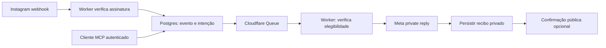

# Arquitetura e limites

Um Cloudflare Worker atende `/mcp`, `/webhooks/instagram`, `/health` e `/privacy`. Queues processa os envios fora do recebimento do webhook. Neon Postgres persiste regras, revisões, eventos, intenções de envio, claims, cooldowns por post, tentativas, recibos e auditoria. Não há processo de servidor sempre ligado.

A persistência ocorre antes do acknowledgment do webhook. Publicação em fila e commit do banco não são uma única transação: o cron de um minuto recupera intenções elegíveis que ficaram sem publicação. A fila pode repetir ou reordenar entregas; claims e unicidade por conta/comentário evitam chamadas concorrentes duplicadas.

O critério de repetição é `(account_id, media_id, commenter_id)`. Regras do mesmo post compartilham o intervalo; posts diferentes são independentes. Um envio incerto reserva apenas seu post até o fim da elegibilidade. Uma rejeição terminal explícita libera somente essa reserva. Uma aceitação inicia o intervalo configurado no momento em que foi registrada.

A confirmação pública tem sua própria intenção, claim, histórico e recibo. Ela nasce somente após persistir um recibo privado. Sua falha nunca transforma uma DM aceita em pendente nem repete a DM. Desativar regras cancela trabalho pendente elegível de ambos os tipos; requisições já iniciadas podem terminar.

Estados privados: `pending`, `retry`, `sending`, `provider_accepted`, `send_unknown`, `skipped`, `blocked`, `failed`, `canceled`. Erros explicitamente rejeitados e temporários têm backoff limitado. Timeouts, redirects, respostas sem recibo válido e envios interrompidos são incertos e não são automaticamente reenviados. Exatamente uma vez no provedor não pode ser garantido sem reconciliação própria da API.

O token de Instagram é criptografado com AES-GCM e vinculado à conta. A renovação usa lease/revisão e só substitui a autorização após validar a mesma conta e persistir ciphertext. O cron renova quando permitido; falhas ficam disponíveis no MCP. Perder a chave exige restaurar backup ou reautorizar; não existe mecanismo para recuperar uma chave perdida pelo MCP.

As migrações são aditivas e versionadas no schema `instagram_automation`. Os testes usam PostgreSQL em memória. A suíte remota opcional só aceita `TEST_DATABASE_URL`, cria um schema aleatório `ig_test_*` e remove apenas esse schema. Ela não deve apontar para o banco de produção.

O projeto não é um serviço multiusuário. Use banco, filas, Worker, chaves e app/autorização próprios em cada instalação. Não conecte duas contas ao mesmo schema esperando isolamento. Não há publicação de mídia, resposta de IA, inbox completo, reconciliação de todos os comentários, confirmação de leitura ou serviço externo de alertas.

Históricos pulados não são automaticamente reenviados ao editar regras. O método interno de reprocessamento de letras finais só aceita um evento explicitamente escolhido, sem tentativas/recibos, ainda elegível, que passou a corresponder a uma regra ativa com essa opção. Antes de usá-lo, o operador deve confirmar o comentário original no post correto. Não existe ferramenta MCP de replay em massa.
